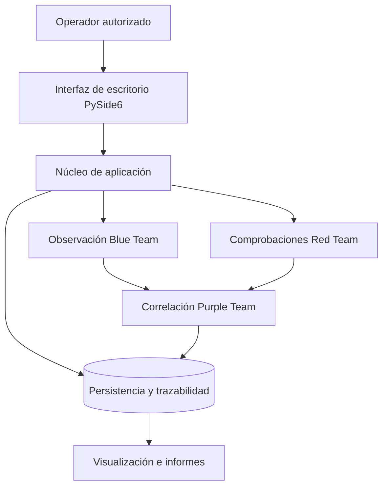

# 🛡️ X-Sentinel AI
### Observación defensiva, validaciones controladas y correlación de evidencia

**Portfolio público · Código fuente propietario y privado**

**Blue Team · Red Team · Purple Team**

---

## ¿Qué es X-Sentinel AI?

**X-Sentinel AI** es una aplicación de escritorio orientada a tareas de seguridad informática en entornos autorizados. Su propósito es reunir, dentro de una misma interfaz, observaciones defensivas, comprobaciones de exposición y correlación técnica de resultados.

El proyecto surgió como una iniciativa de desarrollo aplicada a ciberseguridad y se centra en la **interpretación responsable de evidencia**: por ejemplo, un puerto abierto no implica por sí solo una vulnerabilidad confirmada.

## Áreas principales

| Módulo | Objetivo |
|:---|:---|
| 🔵 **Blue Team** | Observación defensiva de puertos, procesos y servicios locales |
| 🔴 **Red Team** | Comprobaciones de conectividad y exposición de servicios con autorización |
| 🟣 **Purple Team** | Comparación de resultados y análisis de coincidencias o diferencias |
| 📊 **Informes** | Resúmenes técnicos, hallazgos y trazabilidad de las comprobaciones |
| 🧩 **Escritorio** | Interfaz gráfica y persistencia local de resultados |

> **Alcance:** este portfolio describe capacidades y objetivos del proyecto, no un servicio comercial desplegado. Las comprobaciones de red deben ejecutarse solo en sistemas propios o expresamente autorizados. No se afirma detección automática de amenazas ni cobertura de vulnerabilidades que no haya sido validada.

## Tecnologías y prácticas

- **Python** para la lógica de aplicación y las integraciones.
- **PySide6 / Qt** para la experiencia de escritorio en Windows.
- **Persistencia local** y registro de resultados para consulta y trazabilidad.
- **Herramientas de red**, entre ellas Nmap, dentro de flujos de comprobación autorizados.
- **Pruebas automatizadas y validación experimental** durante el desarrollo.
- **Empaquetado para Windows** mediante herramientas de construcción e instalación.

## Arquitectura conceptual

*Diagrama simplificado de las responsabilidades funcionales, no una reproducción del diseño interno propietario.*

## Aspectos técnicos que demuestra

- Desarrollo de software de escritorio con **interfaces gráficas y procesos operativos**.
- Integración de herramientas, interpretación de resultados y presentación de evidencia.
- Distinción entre **conectividad, exposición y vulnerabilidad**.
- Diseño de validaciones controladas, trazabilidad y reportes.
- Aplicación de conceptos de **Blue Team, Red Team y Purple Team** en un mismo flujo.

## Capturas y demostración

Se agregarán capturas seleccionadas y una demostración sin información sensible, direcciones de redes privadas, credenciales ni identificadores de clientes.

## Código fuente y propiedad intelectual

Este repositorio es exclusivamente una **presentación pública del proyecto**. No contiene código fuente del producto, configuraciones privadas, bases de datos, resultados sensibles ni componentes reutilizables de la aplicación.

---

**X-Sentinel AI · Software aplicado a ciberseguridad · 2026**

